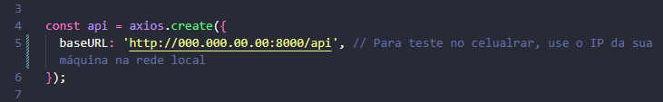
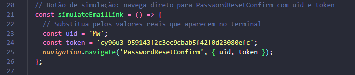

# Frontend Todo-app


Essa é uma aplicação feita para o frontend de um aplicativo de tarefas, desenvolvida com react native e typescript.


   


## Pré-requisitos
Antes de iniciar o projeto, certifique-se de que os seguintes itens estão instalados e configurados:


### Ambiente de desenvolvimento


Node.js (versão recomendada: 18.x ou superior) diponível para download em https://nodejs.org/en/download


npm (já incluído na instalação do Node.js) ou Yarn


### Git
Para controle do versionamento foi utilizada a ferramenta Git que pode ser baixada em diferentes sistemas operacionais pelo link a seguir:


https://git-scm.com/downloads


### Visual Studio Code
Para executar os programas foi utilizado o software Visual Studio Code disponível para download em:


https://code.visualstudio.com/download


### Expo


Expo CLI (para visualizar a aplicação)


````
npm install -g expo-cli
````


Dispositivo físico Android ou iOS com modo desenvolvedor ativado, e o aplicativo Expo Go.


### Backend


 - Backend (Django)
 - Python 3.10 ou superior


 - Django 4.x


 - Django REST Framework


 - SimpleJWT (para autenticação com tokens)


 - Banco de dados configurado (SQLite)


A instalação do backend pode ser encontrada no README do repositório Backend-app-tarefas nesse perfil.


Certifique-se de que o backend está rodando localmente e acessível via IP para o app React Native (exemplo: http://000.000.00.00:8000/api).


### Dependências


 - Navegação react native


 - Stack de navegação react native


 - Axios


 - Async Storage


Os comandos de instalação estão na próxima sessão


## Instalação e execução


Clone o repositório e instale as dependências:


````
git clone https://github.com/joicemqs/Frontend-app-tarefas
cd seu-projeto
npm install # Windows
yarn install # Mac ou Linux
````


Após clonar o repositório, instale as dependências do projeto com os seguintes comandos:


````
npm install @react-navigation/native


npx expo install react-native-screens react-native-safe-area-context react-native-gesture-handler react-native-reanimated


npm install @react-navigation/native-stack


npm install axios


npx expo install @react-native-async-storage/async-storage
````


### Execução


Antes de iniciar o aplicativo mude no arquivo api.ts, na pasta services/, a baseURL da api, já atualizada com o IP do cmputador utilizado para o servidor do backend.





Para iniciar o app:


````
npm start
````


Use o QR Code no terminal para abrir no aplicativo Expo Go ou execute em um emulador configurado.


## Autenticação


Este projeto utiliza autenticação baseada em JWT com refresh automático de token. Ao fazer login, o backend retorna:


 - access token: usado para autenticar requisições


 - refresh token: usado para renovar o access token quando ele expira


Os tokens são armazenados com segurança usando AsyncStorage. O Axios está configurado com interceptors para:


 - Adicionar o access token em todas as requisições


 - Detectar expiração do token e renovar automaticamente usando o refresh token


 - Redirecionar para a tela de login caso o refresh falhe


### Detalhes de Teste


O registro de novo usuário e Login podem ser feitos normalmente pelo próprio aplicativo, assim como a adição, remoção, e edição de tarefas após autenticação.


Porém para realizar a recuperação de senha é necessário consultar o link de redefinição disponível no terminal do servidor Django, adicionar  o uid e token manualmente no arquivo de LoginScreen.py, e escrever a nova senha na tela de redefinição, acessada pelo botão "Simular clique no e-mail (navegar direto)" na tela de login, para redefinir a senha.





## Licença


[MIT](https://choosealicense.com/licenses/mit/)